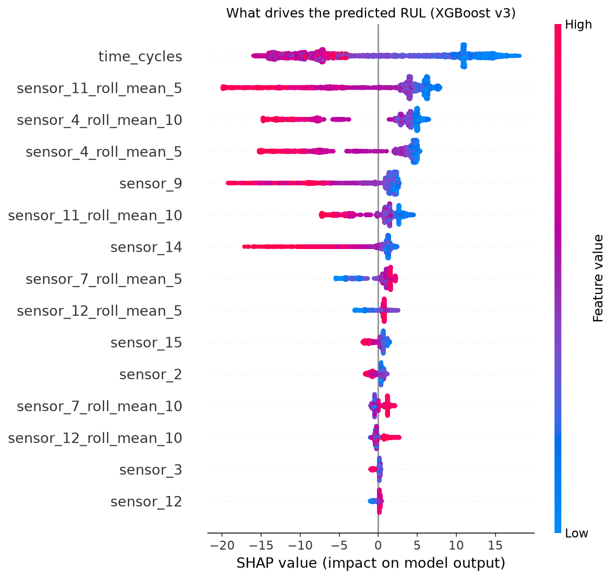
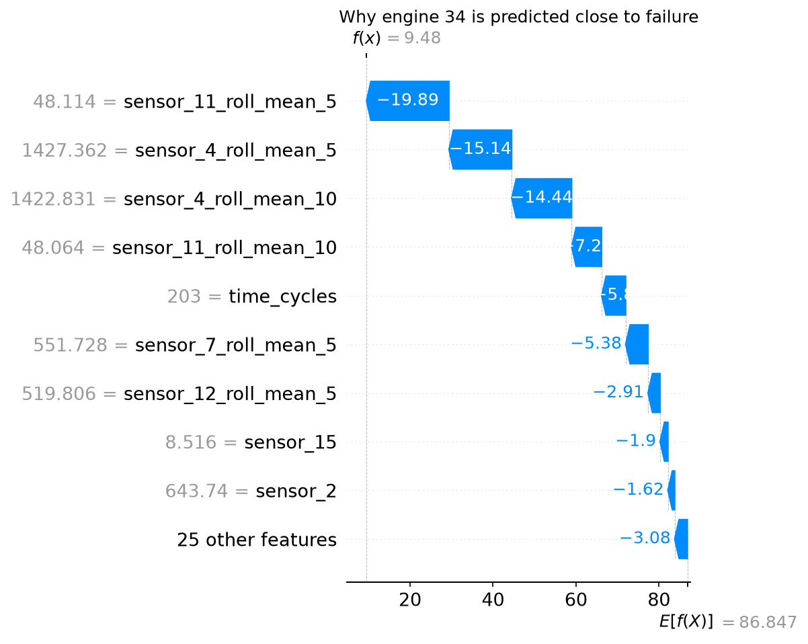
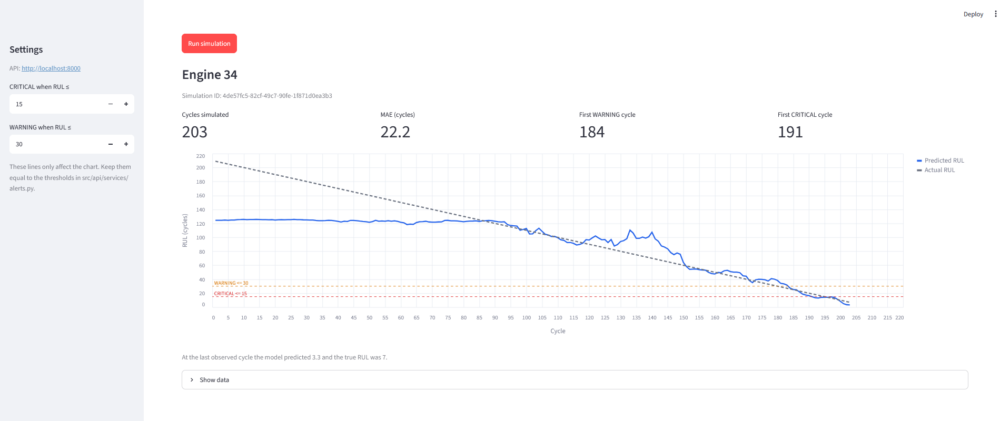
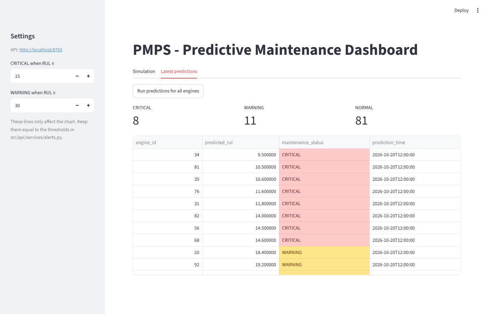

# PMPS — Predictive Maintenance Platform System

[](https://github.com/Sohilaeldally/PMPS/actions/workflows/ci.yml)

End-to-end predictive maintenance pipeline for turbofan jet engines, built on
NASA's C-MAPSS (FD001) dataset. It predicts each engine's **Remaining Useful
Life (RUL)** from sensor readings, stores predictions in PostgreSQL, serves
them through a REST API, and sends **email alerts** automatically through n8n
when an engine needs maintenance.

## Demo

Alert emails sent by the n8n workflow (shown in a Mailtrap sandbox inbox):

<table align="center">
  <tr>
    <td align="center">
      <b>CRITICAL</b> — engine 34, predicted RUL 9 cycles
    </td>
  </tr>
  <tr>
    <td align="center">
      <p align="center">
        
      </p>
    </td>
  </tr>
</table>

## Pipeline

```
Sensor Data → Cleaning / Feature Engineering → GRU (or XGBoost) → RUL Prediction
            → PostgreSQL → FastAPI → n8n Automation → Maintenance Alerts (email)
```

Everything runs in Docker (PostgreSQL + API); n8n runs alongside it as a
separate container.

## Dataset

[NASA C-MAPSS (FD001)](https://www.nasa.gov/intelligent-systems-division/discovery-and-systems-health/pcoe/pcoe-data-set-repository/) —
100 training engines and 100 test engines, 1 operating condition, 1 fault
mode (HPC degradation), 21 sensor channels per cycle. The three FD001 files
are included in `data/`.

## Model

XGBoost regressor trained on:

- the selected raw sensor / operating-setting columns, and
- rolling-window features (mean and std over 5 and 10 cycles) for sensors
  4, 7, 11 and 12,

with the training RUL **capped at 125 cycles** (piecewise-linear degradation,
standard practice on this dataset).

Three model versions are kept in `models/`, each built in a notebook and
reproducible with a script in `src/ml/`:

| Version | What changed | File |
|---|---|---|
| v1 | Baseline XGBoost | `models/final_xgboost.json` |
| v2 | + rolling-window features | `models/final_xgboost_v2.json` |
| v3 | + rolling features + RUL cap 125 (XGBoost option, `MODEL_TYPE=xgboost`) | `models/final_xgboost_v3.json` |

### Results

Evaluated on the untouched FD001 test set (all 100 engines, last cycle of
each) — see `notebooks/05_test_evaluation.ipynb`:

| Model | RMSE | MAE | R² | C-MAPSS score (lower is better) |
|---|---|---|---|---|
| v1 | 25.29 | 18.32 | 0.63 | 5228 |
| v2 | 25.62 | 19.03 | 0.62 | 4741 |
| v3 (XGBoost) | 18.12 | 13.48 | 0.81 | 619 |
| GRU (**used by the API by default**) | **14.83** | **11.15** | **0.87** | **406** |

The RUL cap (v3) gave the biggest improvement: early in an engine's life the
sensors show no degradation, so predicting an exact large RUL is not possible
and capping the target at 125 removes that noise.

### XGBoost vs GRU

To check whether a sequence model does better, a 2-layer GRU was trained on
the raw sensors of the last 30 cycles (no hand-made rolling features) with the
same protocol: training RUL capped at 125, scored on the test set at each
engine's last cycle against the true RUL. The best epoch is chosen on held-out
*training* engines, so the test set is never used for tuning; the result is the
average of 3 seeds. Reproduce with `cd src && python -m ml.gru_model` (needs
`pip install torch`, about 7 minutes on CPU).

The GRU is clearly better (RMSE 14.83 vs 18.12, C-MAPSS score 406 vs 619). It
is also better where it matters for alerts (`python -m ml.compare_alerts`,
test set, last cycle of each engine):

| | XGBoost v3 | GRU |
|---|---|---|
| MAE where true RUL ≤ 30 (alert zone) | 10.22 | **3.33** |
| Engines really at RUL ≤ 15 caught as CRITICAL (of 10) | 8, 0 false alarms | 8, 0 false alarms |
| Engines really at RUL ≤ 30 caught as WARNING or worse (of 25) | 18, 1 false alarm | **22**, 1 false alarm |

**Are the alerts early or late?** The tables above look at the last cycle only.
`python -m ml.alert_timing` replays every test engine cycle by cycle and
compares the first cycle where each model raised an alert with the cycle where
it should have (failure cycle minus the threshold). A positive lag means the
alert came late, a negative one means early; "on time" is within ±5 cycles.

| CRITICAL (RUL ≤ 15), 10 engines really there | XGBoost v3 | GRU |
|---|---|---|
| On time (±5 cycles) | 5 | **8** |
| Late (> 5 cycles) | 2 | **0** |
| Early (> 5 cycles) | 1 | 0 |
| Never flagged | 2 | 2 |
| Median lag | +4.0 cycles | **+0.5 cycles** |

| WARNING (RUL ≤ 30), 25 engines really there | XGBoost v3 | GRU |
|---|---|---|
| On time (±5 cycles) | 10 | **13** |
| Late (> 5 cycles) | 7 | 7 |
| Early (> 5 cycles) | 1 | 2 |
| Never flagged | 7 | **3** |
| Median lag | +3.5 cycles | **+1.5 cycles** |

For CRITICAL, the GRU was never late and 8 of 10 alerts came within 5 cycles of
the right moment; XGBoost was late for 2 engines. For WARNING the GRU flags far
more engines, but 7 alerts are still late, so that is where there is room to
improve. This is only 100 test engines and the ±5 tolerance is a choice, so
read it as a clear trend, not a precise measurement.

**Which model does the API serve?** The GRU, by default (`MODEL_TYPE=gru`). The
Docker image therefore includes the CPU build of PyTorch (about 200 MB extra;
the first build takes longer) and the trained GRU (3 seeds + scaler) is in
`models/gru_v1.pt`. XGBoost is still available because it is tiny, fast and
needs no PyTorch: for a smaller image set in `.env`

```
MODEL_TYPE=xgboost
INSTALL_TORCH=0
```

and rebuild (`docker-compose up -d --build`). Without Docker, the GRU needs
`pip install torch`; run `MODEL_TYPE=xgboost uvicorn api.main:app` from `src/`
to use XGBoost instead. The thresholds, database and n8n workflow are
unchanged. The GRU reads the engine's last 30 cycles, so for engines with a
shorter history the first row is repeated as padding.

### Cross-validation (engine-level)

To check that the v3 result is not a lucky split, the model was evaluated with
5-fold `GroupKFold` on the training set, grouped by engine: all rows of an
engine stay in the same fold, so each fold is tested on 20 engines the model
has never seen. Reproduce with `cd src && python -m ml.cross_validation`.

| Metric (mean ± std over 5 folds) | Value |
|---|---|
| RMSE | 16.71 ± 0.78 |
| MAE | 12.02 ± 0.66 |
| R² | 0.84 ± 0.01 |
| MAE where true RUL ≤ 30 (the alert zone) | 7.65 ± 1.44 |

The scores are stable across folds and close to the test-set RMSE (18.12). The
test number is a bit higher because it is measured only at each engine's last
observed cycle, a harder point than the average cycle. Near failure (RUL ≤ 30)
the error is smaller, about 7.7 cycles on average, which is the zone that
matters for alerts.

### Experiment tracking (MLflow)

`python -m ml.track_experiments` (from `src/`, needs `pip install mlflow`)
evaluates every saved model (XGBoost v1, v2, v3 and the GRU) on the test set
and logs its parameters, metrics and model file to a local MLflow database.
Browse and compare the runs in the MLflow UI, from the project root:

```bash
mlflow ui --backend-store-uri sqlite:///mlflow.db
```

then open http://localhost:5000. The logged metrics are RMSE, MAE, R², the
C-MAPSS score and the MAE where the true RUL is ≤ 30 (the alert zone). They
match the results table above. One thing the alert-zone column shows: the RUL
cap of v3 improves the overall error, but v1 is slightly better than v3 inside
the alert zone (MAE 9.4 vs 10.2); only the GRU is clearly better there (3.3).

### Explainability (SHAP)

`python -m ml.explain` (from `src/`, needs `pip install shap`) explains the
XGBoost v3 model with SHAP: each feature gets a contribution, in cycles, to
every prediction. Sensor 11, 4, 9 and 14 (and their rolling means) matter most
after `time_cycles`.

<p align="center">
  
</p>

A simpler way to read the same result: one feature at a time, with the
feature's value on the x axis and its effect on the predicted RUL (in cycles)
on the y axis. Above 0 the feature adds life, below 0 it removes life. For
example, once the 5-cycle average of sensor 11 passes about 47.6, its effect
drops from about +5 to -20 cycles.

<p align="center">
  
</p>

Reading the plot: each dot is one row; red = high feature value, blue = low.
For example, high `sensor_4` and `sensor_11` rolling means push the predicted
RUL down by 15-20 cycles (the engine is degrading), while low values push it
up. The local view shows why engine 34 is predicted at 9.5 cycles when the
average prediction is 86.8: the recent `sensor_11` and `sensor_4` averages
alone pull it down by about 50 cycles.

<p align="center">
  
</p>

**A finding worth noting:** `time_cycles` is the single most important feature
of the XGBoost model. On FD001 this works because every engine degrades the
same way, but it is partly a shortcut: it learns "an engine that has run for
many cycles is close to the end", which would not hold on engines with
different lifetimes. The GRU is trained without `time_cycles` and still
performs better, which suggests it relies on the sensor behaviour itself.

**Limitations:** trained and evaluated on FD001 only (one operating condition,
one fault mode); predicts from the latest cycle's features and rolling
windows, with no uncertainty estimate.

## Maintenance status rules

The API classifies every predicted RUL (in cycles):

| Predicted RUL | Status |
|---|---|
| ≤ 15 | `CRITICAL` |
| ≤ 30 | `WARNING` |
| > 30 | `NORMAL` |

The logic lives in `src/api/services/alerts.py`.

> These thresholds (15 and 30 cycles) are illustrative defaults, not derived
> from the data or from a maintenance-cost analysis. In a real deployment they
> would be tuned to the lead time needed to schedule maintenance.

## Project structure

```
PMPS/
├── Dockerfile                  # Builds the API image
├── docker-compose.yml          # PostgreSQL + API + dashboard services
├── requirements.txt            # Development (notebooks, training, tests)
├── requirements-api.txt        # Runtime-only dependencies for the API image
├── .env.example                # Copy to .env and set POSTGRES_PASSWORD (+ optional GRU)
├── database/
│   └── schema.sql              # sensor_readings, predictions, simulation_predictions
├── .github/workflows/ci.yml    # CI: tests + Docker builds
├── dashboard/
│   ├── app.py                  # Streamlit dashboard (talks to the API only)
│   ├── Dockerfile
│   └── requirements.txt
├── docs/
│   └── images/                 # Demo screenshots (alert email, dashboard)
├── data/                       # C-MAPSS FD001 files
├── models/                     # Trained models: XGBoost v1-v3, GRU (gru_v1.pt)
├── notebooks/
│   ├── 01_train_eda.ipynb          # Training data exploration
│   ├── 02_test_analysis.ipynb      # Test data analysis
│   ├── 03_baseline_modeling.ipynb  # Baseline models
│   ├── 04_xgboost_tuning.ipynb     # Tuning, rolling features, RUL cap
│   └── 05_test_evaluation.ipynb    # Final test-set evaluation
├── n8n/
│   └── pmps_workflow.json      # Exported n8n alert workflow (import into n8n)
├── tests/
│   └── test_alerts.py          # Unit tests for the status thresholds
├── LICENSE
└── src/
    ├── config.py               # Paths, model features, DB settings
    ├── ml/                     # Preprocessing, training helpers, prediction
    │   ├── preprocessing.py
    │   ├── training.py
    │   ├── cross_validation.py   # Engine-level GroupKFold evaluation
    │   ├── gru_model.py          # Trains the GRU, saves models/gru_v1.pt
    │   ├── gru_predict.py        # GRU inference (used when MODEL_TYPE=gru)
    │   ├── compare_alerts.py     # XGBoost vs GRU on alert metrics
    │   ├── alert_timing.py       # Are the alerts early or late? (XGBoost vs GRU)
    │   ├── explain.py            # SHAP explanations for the XGBoost model
    │   ├── track_experiments.py  # Logs all model versions to MLflow
    │   ├── predict.py
    │   └── xgboost_v1.py / xgboost_v2.py / xgboost_v3.py
    ├── db/                     # Everything that touches PostgreSQL
    │   ├── load_to_db.py       # Loads sensor data into the database
    │   └── queries.py          # Read/write queries
    ├── api/
    │   ├── main.py             # FastAPI app
    │   ├── routes/             # HTTP layer (predictions, simulations)
    │   └── services/           # Business logic (prediction_service, alerts)

```

## Setup

### 1. Clone and install dependencies

```bash
git clone https://github.com/Sohilaeldally/PMPS.git
cd PMPS
python -m venv .venv
source .venv/bin/activate        # Windows: .venv\Scripts\activate
pip install -r requirements.txt
```

### 2. Configure the environment

```bash
cp .env.example .env             # Windows: copy .env.example .env
```

Open `.env` and set `POSTGRES_PASSWORD` to a password of your choice.

### 3. Start PostgreSQL and the API

```bash
docker-compose up -d --build
```

| Service | Container | URL / port |
|---|---|---|
| PostgreSQL | `predmaint_postgres` | `localhost:5433` (host) / `postgres:5432` (inside Docker) |
| FastAPI | `predmaint_api` | http://localhost:8000 |
| Dashboard | `predmaint_dashboard` | http://localhost:8501 |

Interactive API docs: http://localhost:8000/docs

### 4. Tables

The tables are created automatically from `database/schema.sql` the first
time the database container starts (empty volume). If you started the
database before this was added, create them once manually:

```bash
docker exec -i predmaint_postgres psql -U predmaint -d predictive_maintenance_db < database/schema.sql
```

On Windows PowerShell use:
`Get-Content database/schema.sql | docker exec -i predmaint_postgres psql -U predmaint -d predictive_maintenance_db`

### 5. Load the sensor data

The loader reads `data/test_FD001.txt` and inserts it into `sensor_readings`.
Run it from the `src/` folder (the database is reachable on `localhost:5433`):

```bash
cd src
python db/load_to_db.py
```

Run this **once** — running it again inserts the rows a second time.

### 6. (Optional) Retrain a model

The trained models are already in `models/`. To retrain, either run the
notebooks in order (`01` → `05`), or run a training script from `src/`:

```bash
cd src
python -m ml.xgboost_v3
```

The API loads `models/gru_v1.pt` by default (or `models/final_xgboost_v3.json` when `MODEL_TYPE=xgboost`).

### Running the API without Docker

```bash
cd src
uvicorn api.main:app --reload
```

This needs PostgreSQL running (`docker-compose up -d postgres`).

## API endpoints

| Method | Endpoint | Description |
|---|---|---|
| GET | `/` | Health check |
| GET | `/predictions/latest` | Latest prediction per engine, with `maintenance_status` |
| GET | `/predictions/history/{engine_id}` | Full prediction history for one engine |
| POST | `/predictions/run-all` | Run and store a new prediction for **every** engine; returns counts per status |
| POST | `/predictions/{engine_id}` | Run and store a new RUL prediction for one engine |
| POST | `/simulations/{engine_id}` | Replay an engine's life cycle by cycle and store every prediction; returns a `simulation_id` |
| GET | `/simulations/{simulation_id}` | Cycle-by-cycle results of a simulation run |

Example:

```bash
curl -X POST http://localhost:8000/predictions/run-all
curl -X POST http://localhost:8000/predictions/1
curl http://localhost:8000/predictions/latest
curl -X POST http://localhost:8000/simulations/1
```

### Simulations

A simulation walks through one engine's history cycle by cycle, predicting
RUL using only the data available up to that cycle. Each run gets its own
`simulation_id` (UUID), so the same engine can be simulated many times
without overwriting earlier runs. Results are stored in
`simulation_predictions` and can be compared against the true RUL.

## Dashboard

A Streamlit dashboard on top of the API: pick an engine, run a simulation, and
see predicted vs actual RUL with the WARNING / CRITICAL threshold lines, the
MAE, and the first cycle where each status was reached. A second tab shows the
latest prediction for every engine, colour-coded by status.

**Simulation tab** — predicted vs actual RUL for engine 34, served by the GRU.
The alerts arrive close to the right moment (first WARNING at cycle 184, first
CRITICAL at cycle 191; the true crossings are at 180 and 195). The MAE of 22.2
is inflated by the first ~90 cycles, where the true RUL is above the 125 cap
used in training and the model predicts a flat ~125 by design:

<p align="center">
  
</p>

**Latest predictions tab** — status counts (CRITICAL / WARNING / NORMAL) and
the colour-coded table for all engines:

<p align="center">
  
</p>

With Docker it starts together with the API (`docker-compose up -d --build`)
and is available at http://localhost:8501.

Or run it locally (the API must be up):

```bash
pip install -r dashboard/requirements.txt
python -m streamlit run dashboard/app.py
```

It opens at http://localhost:8501. To point it at another API, set the
`API_URL` environment variable (default `http://localhost:8000`). The
threshold lines in the sidebar only affect the chart; keep them equal to the
values in `src/api/services/alerts.py`.

## n8n alert automation

An n8n workflow turns predictions into email alerts:

```
Schedule Trigger (daily, 9:00)
        ↓
HTTP Request  → POST /predictions/run-all   (refresh predictions)
        ↓
HTTP Request  → GET  /predictions/latest
        ↓
Filter        → keep only CRITICAL and WARNING engines
        ↓
Loop (1 item at a time) → Send Email → Wait 12 s → next engine
```

One email is sent per engine that needs attention, 12 seconds apart, so
email providers with rate limits (e.g. Mailtrap's free sandbox) accept them
all.

The email contains the engine ID, status, predicted RUL and prediction time.


### Set it up

1. Run n8n (locally in Docker, UI at http://localhost:5678).
2. In n8n: **Workflows → Import from file →** `n8n/pmps_workflow.json`.
3. In the HTTP Request node, make sure the URL points to the API as seen
   **from the n8n container**, e.g. `http://host.docker.internal:8000/predictions/latest`.
4. Create an **SMTP credential** and attach it to the *Send Email* node. For
   testing, [Mailtrap](https://mailtrap.io) Email Sandbox works well
   (host `sandbox.smtp.mailtrap.io`, port `2525`, no real emails are sent).
5. Run the workflow.

Credentials are not stored in the exported workflow file; you must create
them in your own n8n instance.

## Tests

```bash
pytest tests
```

Unit tests cover the CRITICAL / WARNING / NORMAL thresholds.

## Tech stack

Python · pandas · scikit-learn · XGBoost · FastAPI · PostgreSQL · psycopg2 ·
Docker / Docker Compose · n8n

## License

MIT — see [LICENSE](LICENSE).

## Author

Sohila Reda — [@Sohilaeldally](https://github.com/Sohilaeldally)